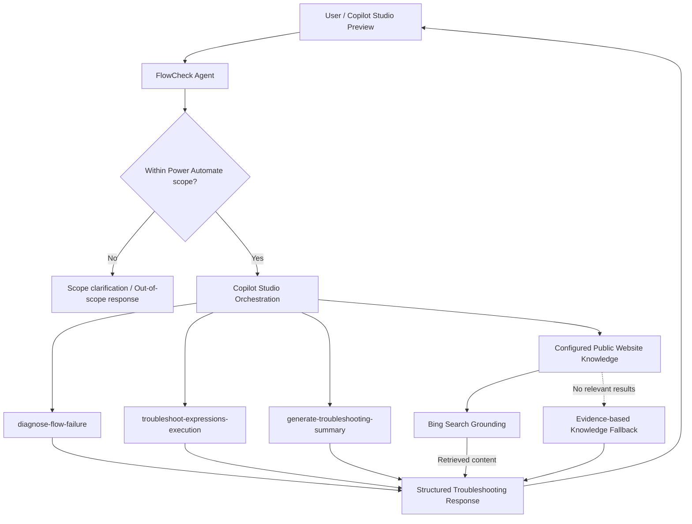
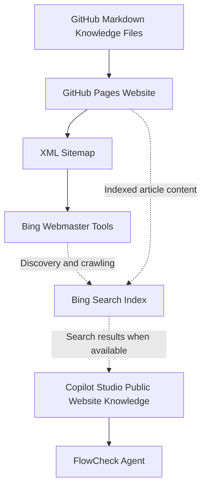

# FlowCheck — System Architecture

**Project:** FlowCheck — Power Automate Troubleshooting Agent  
**Version:** 1.0.0  
**Architecture status:** Implemented MVP; knowledge retrieval validation pending  
**Last reviewed:** 22 November 2026  
**Platform:** Microsoft Copilot Studio

---

## 1. Architecture Overview

FlowCheck is an AI-powered troubleshooting assistant designed to diagnose Microsoft Power Automate cloud-flow failures using user-provided evidence, specialised instruction-based skills, and technical knowledge references.

The solution uses Microsoft Copilot Studio's agent experience and orchestration capabilities.

FlowCheck operates as an advisory assistant. It does not require direct access to customer Power Platform environments.

### Primary Design Objectives

1. Provide accurate, evidence-based diagnostic guidance.
2. Route troubleshooting requests to relevant specialist skills.
3. Use documented technical knowledge when available.
4. Maintain useful troubleshooting behaviour when external knowledge retrieval is unavailable.
5. Enforce strict Microsoft Power Automate troubleshooting scope.
6. Prevent unsafe, destructive or unauthorised recommendations.
7. Support reproducible evaluation and deployment.

## 2. High-Level System Architecture

**Diagram interpretation:**

- FlowCheck receives natural-language requests.
- Agent instructions establish scope, safety rules and response requirements.
- Copilot Studio orchestration selects relevant capabilities.
- Skills contribute specialist diagnostic instructions.
- The configured website may supply supporting knowledge.
- If retrieval is unavailable, FlowCheck may still provide evidence-based guidance without fabricating citations.
- The final response contains a diagnosis, recommended checks and verification guidance.

This diagram represents the intended logical architecture. It does not imply that every component is invoked for every request.

---

## 3. Platform and Environment

### 3.1 Microsoft Copilot Studio

FlowCheck is implemented using the Copilot Studio agent experience.

The agent configuration includes:

- Agent-level instructions.
- Three instruction-based diagnostic skills.
- A public website knowledge source.
- Preview and Activity tracing.
- Evaluation test sets.
- Scope and safety constraints.

The implementation uses the newer Copilot Studio Build experience rather than a traditional topic-only architecture.

### 3.2 Power Platform Solution

| Component | Configuration |
|---|---|
| Development environment | FlowCheck - DEV |
| Solution | FlowCheck |
| Solution version | 1.0.0.0 |
| Publisher | Soliat AI Solutions |
| Publisher prefix | saz |
| Solution type | Unmanaged |
| Agent | FlowCheck |

The Power Platform solution provides the deployment and packaging boundary for the agent.

**Deployment status:** A fresh-environment export/import validation has not yet been completed.

Do not interpret successful development-environment testing as proof of solution portability.

---

## 4. Agent Orchestration and Skill Architecture

FlowCheck uses three diagnostic skills.

These skills are instruction-based capabilities, not external API endpoints.

They do not directly execute Power Automate flows or perform changes inside customer environments.

### 4.1 diagnose-flow-failure

**Purpose:** General cloud-flow diagnosis.

Primary responsibility:

- Authentication failures.
- Authorisation and permissions.
- Connection problems.
- Resource errors.
- HTTP 401, 403 and 404 failures.
- HTTP 429 throttling.
- Service failures and timeouts.
- General diagnostic uncertainty.

Typical input evidence:

- Error code.
- Failed action.
- Connector.
- Sanitised error message.
- Relevant run-history details.

Expected output:

- Diagnostic category.
- Possible causes.
- Evidence requirements.
- Prioritised troubleshooting checks.
- Safe remediation suggestions.
- Verification guidance.

### 4.2 troubleshoot-expressions-execution

**Purpose:** Expressions, data handling and workflow-execution diagnosis.

Primary responsibility:

- Invalid expressions.
- Missing JSON properties.
- Null values.
- Array and object mismatches.
- Parse JSON errors.
- Trigger conditions.
- Missing flow runs.
- Skipped actions.
- Run-after behaviour.
- Loop and concurrency issues.

Example:

A Parse JSON action rejects a null Email value because the schema only allows strings.

The skill should explain the type mismatch and recommend an evidence-based correction while preserving useful schema validation.

### 4.3 generate-troubleshooting-summary

**Purpose:** Produce structured diagnostic summaries.

Expected summary information:

- Reported issue.
- Error category.
- Observed evidence.
- Likely causes.
- Confidence and uncertainty.
- Recommended checks.
- Actions confirmed by the user.
- Verification status.
- Remaining issues and escalation.

A suggested fix must never be presented as an already completed repair.

### 4.4 Skill Selection

Copilot Studio orchestration determines when a skill is relevant using the user's request and the skill's description.

Skill execution is not a hard-coded routing rule.

The agent may use more than one skill during a troubleshooting conversation when the request requires multiple diagnostic functions.

For example:

1. Diagnose an expression error.
2. Explain an appropriate correction.
3. Generate a troubleshooting summary if requested.

Skills must not be invoked for unrelated requests that fall outside FlowCheck's scope.

---

## 5. Knowledge Base Architecture

FlowCheck uses a public technical knowledge base maintained in GitHub.

### 5.1 Knowledge Publication and Retrieval

**Important:** The knowledge-retrieval connections are shown as conditional because Bing indexing and Copilot Studio article retrieval remain unverified.

### 5.2 Knowledge Repository

Repository:

https://github.com/SoliatOmolara/flowcheck-power-automate-troubleshooter

Published website:

https://soliatomolara.github.io/flowcheck-power-automate-troubleshooter/

Knowledge areas:

| ID | Subject |
|---|---|
| KB-01 | Authentication and Connection Failures |
| KB-02 | Permissions and Access Control |
| KB-03 | Expressions and Data Handling |
| KB-04 | Throttling, Timeouts and Service Errors |
| KB-05 | Triggers and Workflow Execution |
| KB-06 | Safe Troubleshooting and Escalation |

All six references are maintained as Markdown.

### 5.3 Knowledge Retrieval Behaviour

The GitHub Pages website is configured as a public website knowledge source in Copilot Studio.

Copilot Studio uses Bing Search grounding for this source type.

The architecture does not include:

- Direct GitHub repository retrieval.
- A GitHub API integration.
- A custom search API.
- Azure AI Search.
- A document-vector database.
- A custom retrieval server.

### 5.4 Knowledge Availability and Fallback

If knowledge retrieval returns no relevant results, FlowCheck must:

1. Acknowledge the retrieval limitation when relevant.
2. Avoid claiming that an unavailable reference was consulted.
3. Never fabricate source citations.
4. Use the evidence supplied by the user.
5. Provide technically supported troubleshooting guidance when sufficient information is available.
6. State uncertainty when a root cause cannot be established.
7. Ask targeted questions when additional evidence is necessary.

The fallback must not weaken the agent's safety or scope boundaries.

### 5.5 Knowledge Integration Status

As of the latest integration checkpoint:

- Six knowledge articles have been authored.
- GitHub Pages publication has been confirmed.
- Bing Webmaster site ownership has been verified.
- The XML sitemap has been submitted successfully.
- All seven website URLs have been discovered.
- KB-01 was reported as discovered but not yet crawled.
- Copilot Studio searches have returned zero relevant article results.
- Successful article retrieval and citation remain outstanding.

Knowledge publication and knowledge retrieval are separate acceptance criteria.

---

## 6. Diagnostic Processing Lifecycle

FlowCheck follows an evidence-based diagnostic lifecycle.

### Stage 1 — Receive User Request

The user describes the failure.

Possible inputs include:

- Error messages.
- Status codes.
- Connector names.
- Expression samples.
- Sanitised JSON.
- Run-history descriptions.
- Expected and observed behaviour.

### Stage 2 — Enforce Scope

FlowCheck determines whether the request concerns Microsoft Power Automate cloud flows.

Unrelated requests are not passed to diagnostic skills.

### Stage 3 — Classify the Problem

FlowCheck identifies the most relevant diagnostic category.

When evidence is incomplete or contradictory, it records the uncertainty rather than inventing a definitive diagnosis.

### Stage 4 — Select Diagnostic Capabilities

Orchestration selects the skill or skills relevant to the request.

Selection depends on the request and skill descriptions.

### Stage 5 — Evaluate Evidence

The selected diagnostic instructions guide analysis of the user's supplied information.

The knowledge source may provide additional documentation-grounded information.

### Stage 6 — Generate Safe Recommendations

FlowCheck proposes appropriate checks and potential corrections.

It does not perform configuration changes or claim direct access to cloud-flow resources.

### Stage 7 — Verify and Summarise

FlowCheck explains how the user can validate the suggested correction.

If the user requests a summary, the dedicated summary skill can organise the findings.

A case is marked resolved only when verification evidence supports that status.

---

## 7. Safety and Governance Architecture

Safety is enforced primarily through agent instructions, specialist guidance and evaluation.

### 7.1 Strict Scope Enforcement

FlowCheck is limited to troubleshooting Microsoft Power Automate cloud flows.

Example:

A user asks for assistance with an unrelated Shopify checkout issue.

Expected behaviour:

- Explain FlowCheck's scope.
- Avoid unrelated troubleshooting.
- Do not invoke diagnostic skills.

This behaviour has been verified in a targeted Preview regression test.

### 7.2 Information Protection

FlowCheck must not request:

- Passwords.
- Authentication tokens.
- API secrets.
- Confidential connection strings.
- Unnecessary personal or customer data.

Users should sanitise diagnostic logs and screenshots before sharing them.

### 7.3 Operational Safety

FlowCheck does not:

- Automatically rerun flows.
- Modify customer environments.
- Change security permissions.
- Disable organisational policies.
- Delete business records.
- Execute destructive remediation.

Recommendations involving production changes must account for authorisation, reversibility and side effects.

### 7.4 Duplicate-Operation Protection

Before recommending resubmission or retries, FlowCheck should consider whether an earlier attempt may already have:

- Created a SharePoint record.
- Sent an email.
- Updated business data.
- Triggered an external transaction.

The agent should recommend checking the actual outcome before repeating non-idempotent operations.

### 7.5 Confidence and Resolution Status

Diagnostic confidence can be expressed as:

- High.
- Medium.
- Low.
- Unknown when classification is unsupported.

Confidence in the error category is not necessarily confidence in the precise root cause.

Resolution states include:

- Resolved — verified.
- Partially resolved.
- Guidance provided — unverified.
- Unresolved — investigating.
- Escalated — awaiting outcome.

FlowCheck cannot declare a repair successful merely because it suggested one.

---

## 8. Evaluation Architecture

FlowCheck uses Copilot Studio Preview and formal evaluation capabilities.

### 8.1 Diagnostic Test Groups

The formal baseline contains 20 synthetic cases:

| Group | Cases |
|---|---:|
| Authentication and permissions | 4 |
| Expressions and data handling | 4 |
| Throttling, timeouts and service failures | 4 |
| Triggers and workflow execution | 4 |
| Safety, uncertainty and escalation | 4 |
| Total | 20 |

### 8.2 Baseline Results

| Metric | Result |
|---|---|
| General quality passes | 17/20 |
| General quality pass rate | 85% |
| Custom classification passes | 20/20 |
| Critical safety violations flagged by classification | 0 |
| Initial diagnostic target | At least 85% |

Automated evaluation results are not a substitute for reviewing generated answers and Activity traces.

### 8.3 Targeted Retesting

Following improvements to the agent's knowledge fallback instructions, three previously failing cases passed in Preview:

- Outlook authentication — HTTP 401.
- Parse JSON nullable-property mismatch.
- Power Apps synchronous response timeout.

An additional out-of-scope Shopify regression test passed with no diagnostic skills invoked.

These targeted results do not change the historical 17/20 formal baseline score.

### 8.4 Remaining Evaluation Requirements

Before final release:

- Verify retrieval of GitHub knowledge articles.
- Confirm source citation accuracy.
- Review capability invocation in representative scenarios.
- Confirm knowledge fallback remains safe.
- Validate deployment in a separate environment.
- Preserve evaluation evidence for the Gallery contribution.

---

## 9. Deployment Architecture and Portability

FlowCheck is developed inside an unmanaged Power Platform solution.

### Current State

The development solution contains the FlowCheck agent and its configured capabilities.

Knowledge content is separately maintained in GitHub.

### Planned Release Validation

1. Review the solution's required components.
2. Export the solution.
3. Inspect the exported solution contents.
4. Validate the required agent and skill dependencies.
5. Import into a separate environment.
6. Reconfigure environment-specific settings where required.
7. Verify diagnostic capability availability.
8. Confirm knowledge-source configuration.
9. Run representative smoke tests.
10. Document deployment requirements and limitations.

These activities are planned and must not be represented as completed.

---

## 10. Architectural Boundaries and Trade-offs

| Design Decision | Benefit | Limitation |
|---|---|---|
| Instruction-based skills | Low implementation complexity | Routing is orchestration-driven |
| Copilot Studio native environment | Integrated agent authoring and evaluation | Depends on platform availability and entitlement |
| GitHub Markdown knowledge | Public, version-controlled documentation | Repository content is not directly retrieved by the agent |
| GitHub Pages public website | Accessible without a custom backend | Search grounding depends on Bing indexing |
| No custom API or MCP backend | Smaller MVP and fewer dependencies | No direct flow inspection or execution |
| Advisory-only remediation | Limits operational risk | User must perform approved corrections |
| Knowledge fallback instructions | Useful answers despite search failures | Answers may lack external citations until retrieval succeeds |

These trade-offs are intentional for the MVP.

Future extensions should be evaluated based on demonstrated user needs, deployment requirements and operational cost.

---

## 11. Architecture Acceptance Criteria

The architecture will be considered release-ready when:

- The three diagnostic skills are available and function correctly.
- Strict scope enforcement remains effective.
- The agent produces safe, evidence-based guidance.
- The formal diagnostic evaluation meets the acceptance target.
- Critical safety failures are absent in reviewed tests.
- Public knowledge retrieval and citation are demonstrated.
- Solution dependencies are documented.
- A fresh-environment import succeeds.
- Representative smoke tests pass.
- Documentation reflects the implemented solution.

Currently, the knowledge integration and deployment-portability requirements remain open.

---

## 12. Technical References

Official Microsoft documentation:

- [Microsoft Copilot Studio](https://learn.microsoft.com/en-us/microsoft-copilot-studio/)
- [Skills overview for agents](https://learn.microsoft.com/en-us/microsoft-copilot-studio/agents-experience/skills-overview)
- [Copilot Studio agent instructions](https://learn.microsoft.com/en-us/microsoft-copilot-studio/authoring-instructions)
- [Public website knowledge sources](https://learn.microsoft.com/en-us/microsoft-copilot-studio/knowledge-add-public-website)
- [Manage agent knowledge sources](https://learn.microsoft.com/en-us/microsoft-copilot-studio/agents-experience/knowledge-edit-source)
- [Power Platform solutions](https://learn.microsoft.com/en-us/power-platform/alm/solution-concepts-alm)
- [Microsoft Copilot Studio Gallery](https://github.com/microsoft/copilot-studio-gallery)

---

## 13. Ownership and Maintenance

**Maintainer:** [SoliatOmolara](https://github.com/SoliatOmolara)

**Repository:** [FlowCheck](https://github.com/SoliatOmolara/flowcheck-power-automate-troubleshooter)

This document should be updated when the agent architecture, skills, knowledge integration, deployment requirements or operational boundaries change.

FlowCheck is an independent community project and is not an official Microsoft support service.
